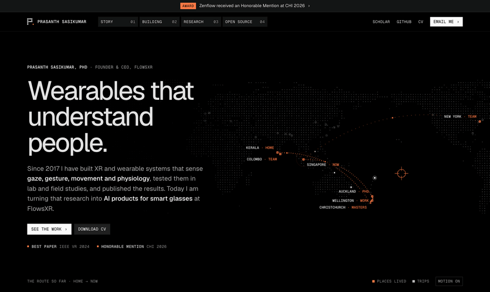
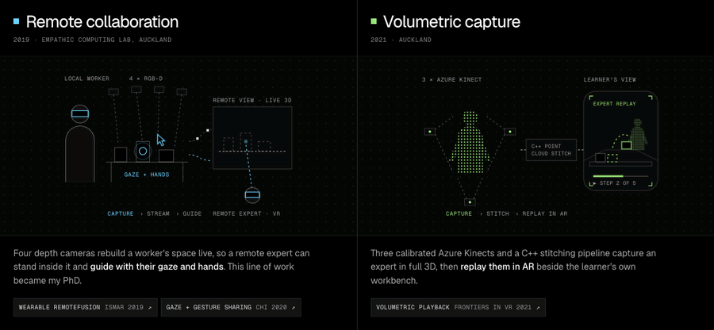
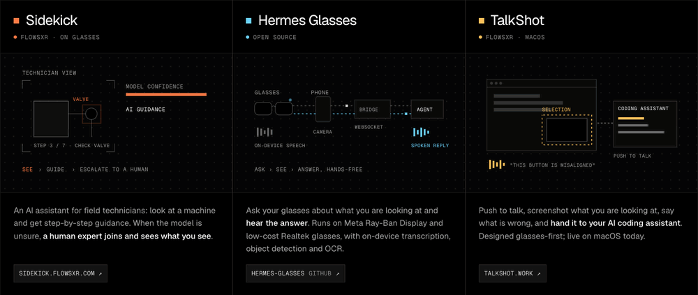
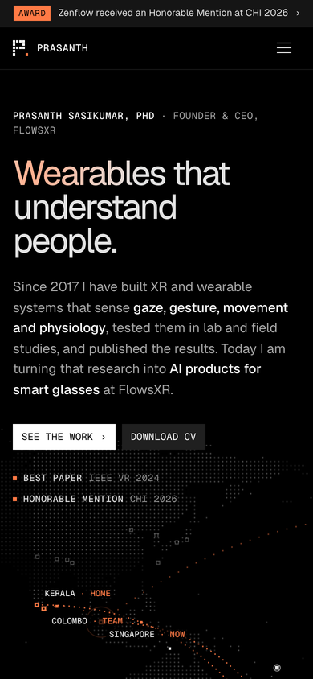
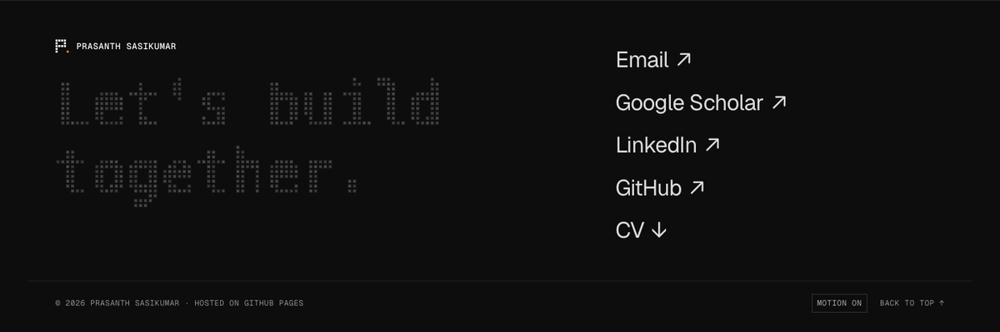

# Personal site template for researchers and builders

I made this template so you can have a polished one-page personal site in about 15 minutes,
without learning a framework. Hand it to an AI coding agent with your CV and it rewrites
everything for you.

See it live with my content: **https://prasanthsasikumar.github.io/**

One page, plain HTML/CSS/JS, no build step, free hosting on GitHub Pages. Every project
gets an animated diagram, there is a "Motion on/off" switch, and the hero is a dot-matrix
map of where you have lived and travelled. It works on phones.



Every chapter of the story gets its own animated diagram. They pause when off screen
and stop entirely with "Motion off".





<p>
  
  &nbsp;
  
</p>

## Make your own (about 15 minutes)

You need a GitHub account and an AI coding agent (Claude Code, Codex, Cursor, Copilot...).

**1. Copy it.** Click **Use this template → Create a new repository**. Name the repository
`<your-github-username>.github.io` (exactly that, or GitHub Pages will not serve it at the root).

**2. Let your agent rewrite it.** Clone your new repo and open a terminal in it. Then use
the prompt for your agent below. Both agents pick up the same guide (`AGENTS.md`), so you get
the same result either way.

**Using Codex?** Run `codex` in the repo folder and paste this prompt:

```
Read AGENTS.md, then make this site about me. Replace every fact, project, paper,
place and link with mine, and draw a new animated figure for each of my projects.
Do not invent anything; ask me if something is missing. When you are done, start
a local preview with `python3 -m http.server 8000` and tell me what to check.
Here is my info:

<paste your CV, or a link to it, your Google Scholar / GitHub / LinkedIn links,
the cities you have lived in with years, and the projects you want shown>
```

**Using Claude?** Run `claude` (Claude Code) in the repo folder and paste this prompt:

```
Read CLAUDE.md and AGENTS.md, then make this site about me. Replace every fact,
project, paper, place and link with mine, and draw a new animated figure for each
of my projects. Do not invent anything; ask me if something is missing. Work
through AGENTS.md's personalising steps in order, and when you are done, start a
local preview with `python3 -m http.server 8000` and tell me what to check.
Here is my info:

<paste your CV, or a link to it, your Google Scholar / GitHub / LinkedIn links,
the cities you have lived in with years, and the projects you want shown>
```

Using another agent (Cursor, Copilot...)? The Codex prompt works there too.

**3. Publish.** Push to `main`. In a minute or two it is live at
`https://<your-github-username>.github.io/`.

To preview before pushing: `python3 -m http.server 8000` and open http://localhost:8000.

## Edit it by hand

| To change | Edit |
|---|---|
| Words, projects, papers, links | `index.html` |
| Map: places, routes, trips | `assets/config.js` |
| Colours | `:root` at the top of `assets/style.css` |

`AGENTS.md` explains the card layout, how to draw the animated figures, and what to check
before pushing. It is written for agents but reads fine for people.

## Credits

Layout and the idea of animated figures per chapter are inspired by
[Shamane Siriwardhana's site](https://shamanez.github.io/). Map land data from
[Natural Earth](https://www.naturalearthdata.com/) (public domain). Fonts: Geist and Geist Mono.

Code is MIT licensed (see `LICENSE`), so use it freely. The example words, papers and project
descriptions are mine; please replace them with yours. If you make a site with it, I would
love to see it.
